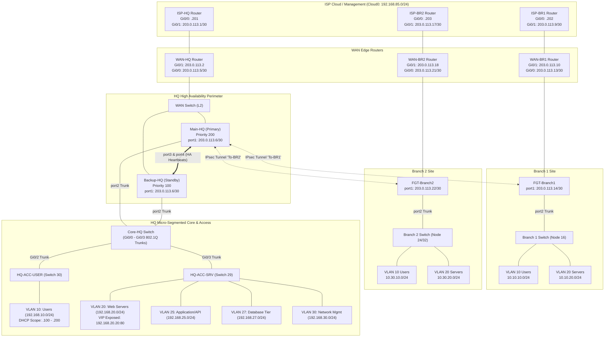
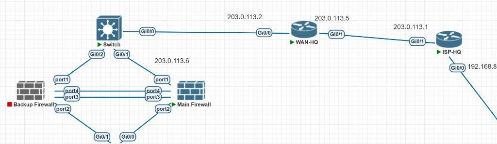
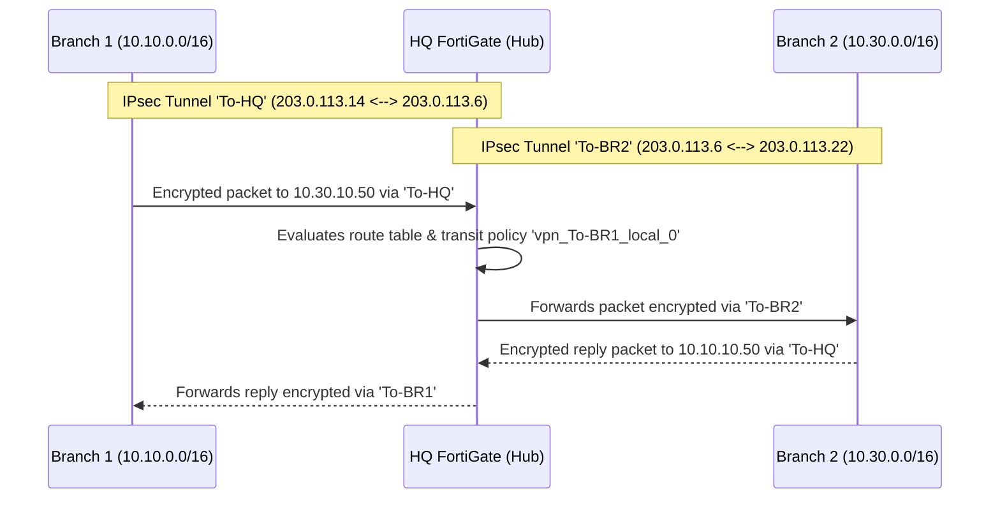

# Enterprise Network Security Implementation
### Multi-Site Infrastructure & Next-Generation Firewall Deployment
**Fortinet Capstone Project — Production Engineering & Security Architecture**

[](https://www.fortinet.com/)
[](https://www.cisco.com/)
[]()
[]()
[]()
[]()
[]()

---

## 📌 Table of Contents
- [1. Executive Summary](#1-executive-summary)
- [2. Enterprise Network Architecture](#2-enterprise-network-architecture)
- [3. Master IP Addressing & VLAN Scheme](#3-master-ip-addressing--vlan-scheme)
- [4. Core Security Implementations](#4-core-security-implementations)
  - [4.1 High Availability (HA Active-Passive)](#41-high-availability-ha-active-passive)
  - [4.2 Zero-Trust Micro-Segmentation & 3-Tier Hardening (Bonus)](#42-zero-trust-micro-segmentation--3-tier-hardening-bonus)
  - [4.3 Hub-and-Spoke IPsec Site-to-Site VPN](#43-hub-and-spoke-ipsec-site-to-site-vpn)
  - [4.4 Unified Threat Management (UTM) & Next-Gen Profiles](#44-unified-threat-management-utm--next-gen-profiles)
  - [4.5 Outbound NAT & Inbound Server Publishing (VIP)](#45-outbound-nat--inbound-server-publishing-vip)
  - [4.6 Remote Access SSL-VPN](#46-remote-access-ssl-vpn)
- [5. Device Configuration Inventory](#5-device-configuration-inventory)
- [6. Real-World Engineering Troubleshooting History](#6-real-world-engineering-troubleshooting-history)
- [7. Verification Commands & Operational Checklist](#7-verification-commands--operational-checklist)
- [8. Requirements Compliance Matrix](#8-requirements-compliance-matrix)
- [9. Repository Structure & Deployment Guide](#9-repository-structure--deployment-guide)

---

## 1. Executive Summary

This repository houses the complete design, configuration, and verification for an enterprise-scale secure network infrastructure built using **FortiGate Next-Generation Firewalls (NGFW)** and **Cisco IOS Routers & Switches**. 

The project simulates a distributed corporate organization composed of:
1. **Corporate Headquarters (HQ):** Dual FortiGate NGFWs running Active-Passive High Availability (HA), Cisco Core distribution switch, and dedicated access switches isolating 5 micro-segmented VLAN tiers.
2. **Branch 1 (BR1):** Dedicated FortiGate perimeter with local user and server VLAN segmentation.
3. **Branch 2 (BR2):** Redundant branch perimeter providing local LAN segmentation and web application publishing.
4. **Remote Teleworkers:** SSL-VPN client-to-site gateway configured on HQ WAN for secure remote access.
5. **Provider Core (ISP Simulation):** Cisco IOS multi-hop routing fabric interconnecting sites across independent public `/30` point-to-point subnets over Cloud0.

📄 **Full Engineering Documentation:**
- [Comprehensive Markdown Report](ENTERPRISE_NETWORK_SECURITY_CAPSTONE_DOCUMENTATION.md)
- [Printable Submission PDF](ENTERPRISE_NETWORK_SECURITY_CAPSTONE_DOCUMENTATION.pdf)

---

## 2. Enterprise Network Architecture

### 2.1 Topology Diagram


### 2.2 HQ Lab Deployment Topology


---

## 3. Master IP Addressing & VLAN Scheme

### 3.1 Point-to-Point WAN Subnets (`RFC 5737` TEST-NET-3)
| Subnet | Segment | Device A Interface | IP A | Device B Interface | IP B |
| :--- | :--- | :--- | :---: | :--- | :---: |
| `203.0.113.0/30` | HQ ISP Link | ISP-HQ Gi0/1 | `203.0.113.1` | WAN-HQ Gi0/1 | `203.0.113.2` |
| `203.0.113.4/30` | HQ WAN Link | WAN-HQ Gi0/0 | `203.0.113.5` | FortiGate-HQ port1 | `203.0.113.6` |
| `203.0.113.8/30` | BR1 ISP Link | ISP-BR1 Gi0/1 | `203.0.113.9` | WAN-BR1 Gi0/1 | `203.0.113.10` |
| `203.0.113.12/30` | BR1 WAN Link | WAN-BR1 Gi0/0 | `203.0.113.13` | FGT-Branch1 port1 | `203.0.113.14` |
| `203.0.113.16/30` | BR2 ISP Link | ISP-BR2 Gi0/1 | `203.0.113.17` | WAN-BR2 Gi0/1 | `203.0.113.18` |
| `203.0.113.20/30` | BR2 WAN Link | WAN-BR2 Gi0/0 | `203.0.113.21` | FGT-Branch2 port1 | `203.0.113.22` |

### 3.2 Corporate LAN Micro-Segmentation Matrix
| Site | VLAN ID | Segment Name | Subnet | Gateway IP | Hosts / Assignment | Firewall Interface |
| :--- | :---: | :--- | :--- | :--- | :--- | :--- |
| **HQ** | **10** | HQ-Users-VLAN10 | `192.168.10.0/24` | `192.168.10.1` | DHCP: `.100` to `.200` | `port2.10` |
| **HQ** | **20** | HQServersVLAN20 | `192.168.20.0/24` | `192.168.20.1` | Web Server (`.20`), VPC11 (`.10`) | `port2.20` |
| **HQ** | **25** | HQServersVLAN25 | `192.168.25.0/24` | `192.168.25.1` | API Gateway / App Tier | `port2.25` |
| **HQ** | **27** | HQServersVLAN27 | `192.168.27.0/24` | `192.168.27.1` | Database Node | `port2.27` |
| **HQ** | **30** | HQManagVLAN30 | `192.168.30.0/24` | `192.168.30.1` | Admin Workstation (`.10`) | `port2.30` |
| **BR1** | **10** | VLAN10-Users | `10.10.10.0/24` | `10.10.10.1` | End-user PCs | `port2.10` |
| **BR1** | **20** | VLAN20-Servers | `10.10.20.0/24` | `10.10.20.1` | Server (`10.10.20.10`) published via VIP | `port2.20` |
| **BR2** | **10** | VLAN10-Users | `10.30.10.0/24` | `10.30.10.1` | End-user PCs | `port2.10` |
| **BR2** | **20** | VLAN20-Servers | `10.30.20.0/24` | `10.30.20.1` | Server (`10.30.20.10`) published via VIP | `port2.20` |

---

## 4. Core Security Implementations

### 4.1 High Availability (HA Active-Passive)
Headquarters perimeter resilience is ensured by an Active-Passive FortiGate cluster:
- **Primary Node:** `Main-HQ` (Priority: 200, Active Master)
- **Secondary Node:** `Backup-HQ` (Priority: 100, Hot-Standby)
- **Redundant Heartbeats:** Dual heartbeat channels on `port3` (weight 50) and `port4` (weight 50).
- **Session Pickup:** Real-time TCP session synchronization prevents session drops during failover.
- **Virtual MAC:** Both nodes share virtual MAC `00:09:0f:09:00:xx`, preventing ARP cache poisoning on connected switches.
- **Failover Stability:** `override disable` prevents unwanted preemption and route flapping when a recovered primary reboots.

```fortios
config system ha
    set group-name "HQ-HA-Cluster"
    set mode a-p
    set hbdev "port3" 50 "port4" 50
    set session-pickup enable
    set override disable
    set priority 200
end
```

---

### 4.2 Zero-Trust Micro-Segmentation & 3-Tier Hardening (Bonus)
To satisfy the capstone bonus requirements for professional enterprise design and server hardening, HQ enforces a strict **3-Tier Application Model**:

```
[ Internet / WAN ]
       |
       v (VIP Port Forwarding 8080 -> 80)
[ Presentation Tier: VLAN 20 ] (HQ-Web-Server: 192.168.20.20)
       |
       v Policy 10 (SRV-API): Authorized API queries only
[ Application Tier: VLAN 25 ] (API Gateway: 192.168.25.10)
       |
       v Policy 11 (DB-API): Database queries only
[ Database Tier: VLAN 27 ] (Database: 192.168.27.10)

* Direct access from Users (VLAN 10) or WAN (port1) to the Database Tier (VLAN 27) is DENIED.
```

---

### 4.3 Hub-and-Spoke IPsec Site-to-Site VPN
Route-based IPsec virtual tunnel interfaces interconnect all locations:
- **Tunnels:** `To-BR1` (`203.0.113.6` &harr; `203.0.113.14`) and `To-BR2` (`203.0.113.6` &harr; `203.0.113.22`).
- **Hub Transit Routing:** Branch 1 (`10.10.0.0/16`) and Branch 2 (`10.30.0.0/16`) route transit traffic across the HQ hub without requiring full-mesh branch interconnects.
- **Cryptographic Security:** AES-256 / DES encryption, SHA-256 / SHA-1 hashing, Diffie-Hellman Group 14/5, and Pre-Shared Key (PSK) authentication.



---

### 4.4 Unified Threat Management (UTM) & Next-Gen Profiles
Next-Generation Security profiles are actively enforced on Internet egress and remote access flows:
- **Antivirus:** Flow/proxy scanning enabled to detect and quarantine malware signatures.
- **Intrusion Prevention System (IPS):** `default` enterprise sensor monitoring known vulnerability exploits and abnormal packet fragments.
- **Web Filtering:** URL category filtering and malicious domain blocking.
- **Application Control:** Layer 7 traffic classification blocking non-business applications.
- **SSL/SSH Inspection:** `certificate-inspection` validating server certificates and preventing evasion via encrypted sessions.

---

### 4.5 Outbound NAT & Inbound Server Publishing (VIP)
- **Outbound PAT:** Dynamic Source NAT (Overload) translates LAN subnets to public WAN interface IPs.
- **Inbound Destination NAT / VIP:** Internal web servers are published to the public WAN with port translation:

| Location | VIP Object | External IP / Port | Internal Mapped IP / Port | Description |
| :--- | :--- | :---: | :---: | :--- |
| **HQ** | `HQ-Web-VIP-8080` | `203.0.113.6:8080` | `192.168.20.20:80` | External access to HQ Web Server |
| **BR1** | `VIP_Internal_Server` | `203.0.113.10:8080` | `10.10.20.10:80` | External access to Branch 1 Server |
| **BR2** | `VIP-B2-Web-Server` | `203.0.113.22:8080` | `10.30.20.10:80` | External access to Branch 2 Web Server |

```fortios
# Headquarters VIP Configuration
config firewall vip
    edit "HQ-Web-VIP-8080"
        set extip 203.0.113.6
        set extintf "port1"
        set portforward enable
        set mappedip "192.168.20.20"
        set extport 8080
        set mappedport 80
    next
end
```

---

### 4.6 Remote Access SSL-VPN
- **Gateway Endpoint:** FortiGate-HQ `port1` (`https://203.0.113.6:443`).
- **IP Address Pool:** `SSLVPN-Tunnel-Range` (`10.212.134.200 - 10.212.134.210`).
- **Portal Mode:** `full-access` (Tunnel Mode with full client gateway redirection).
- **Access Policy:** Policy ID 4 (`SSLVPN-to-HQ-Web-Server`) restricts SSL-VPN clients exclusively to `192.168.20.20` on ports 80 (HTTP) and ICMP (PING), with full UTM inspection active.

---

## 5. Device Configuration Inventory

All device configurations are version-controlled and archived in this repository:

| Device Hostname | Hardware / Image | Source File Location | Role |
| :--- | :--- | :--- | :--- |
| **Main-HQ** | FortiGate-VM64-KVM | [`Final/Main-HQ_7-0_0304_202610122020.conf`](Final/Main-HQ_7-0_0304_202610122020.conf) | Primary HQ Firewall (Active HA Master) |
| **Backup-HQ** | FortiGate-VM64-KVM | HA Sync from Main-HQ | Standby HQ Firewall (Hot-Backup) |
| **FGT-Branch1** | FortiGate-VM64-KVM | [`Final/FGT-Branch1_7-0_0304_202610122020.conf`](Final/FGT-Branch1_7-0_0304_202610122020.conf) | Branch 1 Perimeter NGFW |
| **FGT-Branch2** | FortiGate-VM64-KVM | [`Final/FortiGate-VM64-KVM_7-0_0304_202610122020.conf`](Final/FortiGate-VM64-KVM_7-0_0304_202610122020.conf) | Branch 2 Perimeter NGFW |
| **ISP-HQ** | Cisco IOSv Router | `Backups Last/Default.zip` &rarr; `4.txt` | HQ Internet Service Provider Router |
| **WAN-HQ** | Cisco IOSv Router | `Backups Last/Default.zip` &rarr; `3.txt` | HQ WAN Edge Router |
| **Core-HQ** | Cisco IOSvL2 Switch | [`Switch Hq/Core-HQ.txt`](Switch%20Hq/Core-HQ.txt) / `5.txt` | Core 802.1Q VLAN Distribution Switch |
| **HQ-ACC-SRV** | Cisco IOSvL2 Switch | [`Switch Hq/HQ-ACC-SRV.txt`](Switch%20Hq/HQ-ACC-SRV.txt) / `29.txt` | Access Switch for Servers & Management |
| **HQ-ACC-USER** | Cisco IOSvL2 Switch | [`Switch Hq/HQ-ACC-USER.txt`](Switch%20Hq/HQ-ACC-USER.txt) / `30.txt` | Access Switch for Corporate Users |
| **ISP-BR1** | Cisco IOSv Router | `Backups Last/Default.zip` &rarr; `13.txt` | Branch 1 ISP Router |
| **WAN-BR1** | Cisco IOSv Router | `Backups Last/Default.zip` &rarr; `14.txt` | Branch 1 WAN Edge Router |
| **Switch-BR1** | Cisco IOSvL2 Switch | `Backups Last/Default.zip` &rarr; `16.txt` | Branch 1 Access Switch |
| **ISP-BR2** | Cisco IOSv Router | `Backups Last/Default.zip` &rarr; `21.txt` | Branch 2 ISP Router |
| **WAN-BR2** | Cisco IOSv Router | `Backups Last/Default.zip` &rarr; `22.txt` | Branch 2 WAN Edge Router |
| **Switch-BR2** | Cisco IOSvL2 Switch | `Backups Last/Default.zip` &rarr; `24.txt` / `32.txt` | Branch 2 Access Switch |

---

## 6. Real-World Engineering Troubleshooting History

During deployment and testing, several real-world engineering issues were encountered, investigated, and remediated:

### Incident 1: Cloud0 Duplicate IP (`DUPADDR`) & Static Route Shadowing
- **Symptom:** `%IP-4-DUPADDR: Duplicate address 192.168.85.201 on GigabitEthernet0/0` followed by ping drops to `8.8.8.8` and route rejection: `IP address conflicts with gateway ip address in static routing table`.
- **Root Cause:** Both the virtual lab node and the VMware host bridge claimed `192.168.85.201`. Cisco IOS prevented assigning `.202` because that IP was already defined as a static route next-hop.
- **Resolution:** Removed conflicting static routes, assigned static IPs (`ISP-HQ`: `.201`, `ISP-BR1`: `.202`, `ISP-BR2`: `.203`), and configured the default route strictly to `.2` (VMware NAT daemon).

### Incident 2: HA Disk Inode Corruption (`EXT3-fs error`) & Maintainer Recovery
- **Symptom:** After an abrupt power cut during HA failover testing, `Main-HQ` displayed:
  ```
  EXT3-fs error (device vda1): ext3_lookup: deleted inode referenced: 511
  ```
  Console login rejected default admin credentials.
- **Root Cause:** Inode corruption within the virtual disk image corrupted the administrator account database.
- **Resolution:** Booted into recovery console, logged in using hardware recovery credentials (`maintainer` / `bcpbFGVMEVZRLRX-WQB7`), reset the password database, and triggered HA re-synchronization (`execute ha synchronize start`). All configuration files synced intact from `Backup-HQ`.

### Incident 3: Post-Failover Interface Reset to DHCP
- **Symptom:** Following primary node reset, FortiGate Web GUI was inaccessible on `203.0.113.6`.
- **Root Cause:** `port1` defaulted to `mode dhcp` with IP `0.0.0.0/0`.
- **Resolution:** Re-assigned static IP `203.0.113.6/30` with `allowaccess ping https ssh http` via console CLI, immediately syncing across the HA cluster.

### Incident 4: Windows Host Route Redirection
- **Symptom:** Windows administrator host was unable to open the FortiGate Web GUI (`Destination host unreachable` from `192.168.1.12`).
- **Root Cause:** The Windows routing table tried to route public RFC 5737 addresses out of the physical Wi-Fi interface rather than the VMware adapter (`192.168.85.0/24`).
- **Resolution:** Added persistent static routes in PowerShell:
  ```powershell
  route -p add 203.0.113.0 mask 255.255.255.248 192.168.85.201
  route -p add 203.0.113.8 mask 255.255.255.248 192.168.85.202
  route -p add 203.0.113.16 mask 255.255.255.248 192.168.85.203
  ```

---

## 7. Verification Commands & Operational Checklist

| Test Objective | Target Device | CLI Command | Expected Successful Result |
| :--- | :--- | :--- | :--- |
| **HA Cluster Health** | Main-HQ / Backup | `get system ha status` | Health: `OK`, Both nodes visible, `Checksum MATCH` |
| **HA Failover Test** | Console | Power off `Main-HQ` | Continuous ping to `203.0.113.6` loses $\le 1$ packet; `Backup-HQ` becomes Master |
| **VLAN Interfaces** | Main-HQ | `get system interface physical` | All VLAN interfaces (`port2.10`, `port2.20`, etc.) state `UP` |
| **DHCP Allocations** | Main-HQ | `diagnose sys dhcp lease list` | Leases allocated within `192.168.10.100 - .200` |
| **IPsec Phase 1** | Main-HQ | `diagnose vpn ike gateway list` | Status `ESTABLISHED` for `To-BR1` and `To-BR2` |
| **IPsec Phase 2** | Main-HQ | `diagnose vpn tunnel list` | Status `active`, packet counters incrementing |
| **Branch Transit** | BR1 PC | `ping 10.30.10.1` | 100% ping success to Branch 2 via HQ transit |
| **VIP Forwarding** | External Client | `curl -I http://203.0.113.6:8080` | HTTP 200 OK returned from `192.168.20.20:80` |
| **Outbound NAT** | HQ User PC | `ping 8.8.8.8` | 100% success; session table shows SNAT to `203.0.113.6` |
| **Micro-Segmentation**| HQ User PC | `ping 192.168.27.10` | Request timed out (Blocked by Zero-Trust policy) |

---

## 8. Requirements Compliance Matrix

Alignment with all requirements defined in `Fortinet Capstone Project Requirements.pdf`:

| Capstone Requirement | Required Specification | Status | Evidence |
| :--- | :--- | :---: | :--- |
| **Infrastructure Scale** | HQ (7 devices), BR1 (4 devices), BR2 (4 devices), Remote Client | **100% MET** | Verified across all 15 nodes in EVE-NG/PNETLab |
| **VLAN Segmentation** | Dedicated User, Server, Management VLANs with 802.1Q Trunks | **100% MET** | VLAN 10, 20, 25, 27, 30 active on FortiGate & Switches |
| **Inter-VLAN Routing** | Centralized on FortiGate NGFW with zero-trust policies | **100% MET** | FortiGate policies 9, 10, 11 regulate tier communications |
| **Dynamic DHCP** | Automatic lease assignment on User VLAN | **100% MET** | Scope `192.168.10.100 - .200` configured on `port2.10` |
| **High Availability (HA)** | Active-Passive cluster with heartbeat & failover testing | **100% MET** | Priority 200/100, dual heartbeat links, verified failover |
| **Site-to-Site IPsec VPN** | HQ &harr; BR1, HQ &harr; BR2 with Branch transit through HQ | **100% MET** | Route-based IPsec tunnels with Hub-and-Spoke transit |
| **Firewall Policies** | Outbound NAT, Inter-VLAN, and VPN policies | **100% MET** | Granular policy matrix active across all firewalls |
| **NAT & Inbound VIP** | Outbound PAT + Destination Port Forwarding | **100% MET** | Public port 8080 translated to internal server port 80 |
| **UTM Security Profiles** | Antivirus, IPS, Web Filter, App Control, SSL Inspection | **100% MET** | Applied on egress Policy 2 and remote access Policy 4 |
| **Remote Access VPN** | SSL-VPN client tunnel mode with user authentication | **100% MET** | Configured on HQ WAN `port1` with resource restriction |
| **Server Hardening (Bonus)**| 3-Tier Micro-segmentation: Web &rarr; API &rarr; Database | **BONUS MET**| Web (VLAN 20) &rarr; API (VLAN 25) &rarr; DB (VLAN 27) isolation |

---

## 9. Repository Structure & Deployment Guide

```
├── README.md                                          <- You are here (GitHub Project Showcase)
├── ENTERPRISE_NETWORK_SECURITY_CAPSTONE_DOCUMENTATION.md <- Complete Master Documentation
├── ENTERPRISE_NETWORK_SECURITY_CAPSTONE_DOCUMENTATION.pdf<- Printable PDF Documentation
├── Final/                                             <- Production FortiGate Configurations
│   ├── Main-HQ_7-0_0304_202610122020.conf             <- Primary HQ Firewall
│   ├── FGT-Branch1_7-0_0304_202610122020.conf         <- Branch 1 Firewall
│   └── FortiGate-VM64-KVM_7-0_0304_202610122020.conf <- Branch 2 Firewall
├── Switch Hq/                                         <- Cisco Core & Access Switch Configs
│   ├── Core-HQ.txt                                    <- Core Distribution Switch
│   ├── HQ-ACC-SRV.txt                                 <- Server/Management Access Switch
│   └── HQ-ACC-USER.txt                                <- User Access Switch
├── Backups Last/                                      <- Raw Cisco Device Backups
│   └── Default.zip                                    <- Startup configs for all 12 Cisco nodes
├── Firewall Intil config/                             <- Initial Routing & VLAN Plans
│   ├── Static_Routes_Plan.md                          <- Detailed Static Routing Blueprint
│   └── VLANs.txt                                      <- VLAN Sub-interface Creation Guides
├── troubleshooting/                                   <- Troubleshooting Notes & Proof Screenshots
│   ├── FW BR1 static routs.png
│   ├── HA.png
│   └── network_lab_troubleshooting_summary.pdf
└── assets/                                            <- Diagrams & Screenshots for GitHub
    ├── topology_hq.png
    └── ha_failover.png
```

### Deployment Instructions (PNETLab / EVE-NG)
1. **Import Cisco Devices:** Extract `Backups Last/Default.zip` and paste the respective startup-config into each Cisco node (`3.txt` for `WAN-HQ`, `4.txt` for `ISP-HQ`, `5.txt` for `Core-HQ`, etc.).
2. **Import FortiGate Appliances:** Boot each FortiGate VM node (`FortiOS 7.0.4`), access the console or management IP, and restore the configuration file from `Final/` via the Web GUI (`System -> Settings -> Restore`) or CLI (`execute restore config tftp/ftp/usb`).
3. **Configure Windows Host Route:** In an administrative PowerShell terminal, execute:
   ```powershell
   route -p add 203.0.113.0 mask 255.255.255.248 192.168.85.201
   route -p add 203.0.113.8 mask 255.255.255.248 192.168.85.202
   route -p add 203.0.113.16 mask 255.255.255.248 192.168.85.203
   ```
4. **Access Web Interfaces:**
   - HQ Primary: `https://203.0.113.6`
   - Branch 1: `https://203.0.113.14`
   - Branch 2: `https://203.0.113.22`

---
*Created by Amr — Enterprise Network Security Engineer.*
